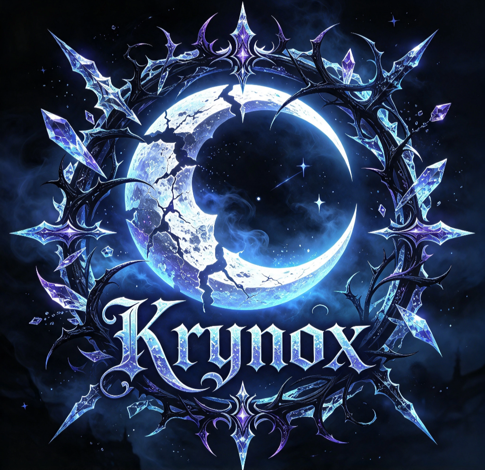

<!DOCTYPE html>
 <html lang="pt-BR">
 <head>
     <meta charset="UTF-8">
     <meta name="viewport" content="width=device-width, initial-scale=1.0">
     <title>Krynox | Família do Jester Carmesim</title>
     
 </head>
 <body>
     

         <!-- Imagem do Valerius -->
         
         <h1>Krynox</h1>
         
A família construída pelo bufão carmesim

         <!-- Brasão / símbolo do grupo -->
         
         <h2>O que é Krynox</h2>
         
Não é um reino antigo, nem uma ordem ancestral. Krynox é a família imortal que Valerius construiu com cuidado, escolhendo cada integrante pessoalmente, um por um.

         
Ele vaga pelas sombras, observa e testa cada alma. Só aqueles que aceitam o chamado, que suportam o frio da noite, passam a fazer parte desse laço eterno. Não há trono nem soberano: só o arauto e os que ele acolheu nas trevas.

         <h2>Valerius, o fundador</h2>
         
O Jester Carmesim é o coração desse grupo. Com sua risada enganadora, a cartola vermelha e a lâmina escondida, ele busca almas que combinem com a sua noite gélida. Cada novo membro recebe o selo do conclave, unido para sempre à família Krynox.

         

             “Eu não construí um exército. Eu reuni uma família, feita de noite, gelo e sangue.”
         

     

 </body>
 </html>
